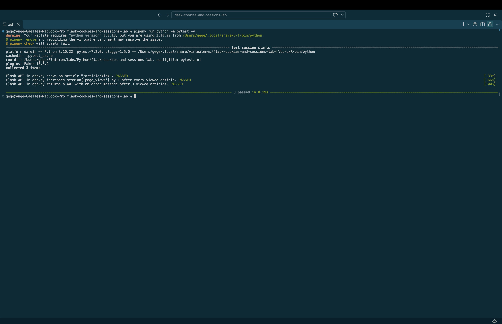

# Flask Cookies and Sessions Lab

## Overview

This project implements a session-based paywall for an article application using Flask and React. Users can view up to three articles before the backend restricts further access.

The purpose of this lab is to practice using cookies and sessions to maintain state across HTTP requests.

## Learning Objectives

- Understand how cookies and sessions work in Flask.
- Store and retrieve data using the Flask session object.
- Track page views across multiple HTTP requests.
- Implement a backend paywall using conditional logic.
- Return appropriate HTTP status codes and JSON responses.
- Test API functionality using pytest.

## Technologies Used

- Python 3.10
- Flask
- Flask-SQLAlchemy
- Flask-Migrate
- Marshmallow
- SQLite
- React
- Pipenv
- pytest

## Features

- Retrieve all articles.
- Retrieve an individual article by ID.
- Initialize a session-based page view counter.
- Increment the counter with every individual article request.
- Allow users to view their first three articles.
- Return a 401 Unauthorized response after three page views.
- Reset the page view counter using the clear session route.

## Installation and Setup

### 1. Clone the Repository

Clone this repository to your local machine:

```bash
git clone git@github.com:a-gbatie/flask-cookies-and-sessions-lab.git
```

```bash
cd flask-cookies-and-sessions-lab
```

### 2. Install Backend Dependencies

From the project root directory, run:

```bash
pipenv install --python 3.10
pipenv shell
```

### 3. Install Frontend Dependencies

```bash
npm install --prefix client
```

### 4. Set Up the Database

```bash
cd server
flask db upgrade
python seed.py
```

### 5. Start the Flask Backend

From the server directory, run:

```bash
python app.py
```

The backend runs at:

http://localhost:5555

### 6. Start the React Frontend

Open a separate terminal from the project root directory:

```bash
npm start --prefix client
```

## API Endpoints

| Method | Endpoint | Description |
| ------ | -------- | ----------- |
| GET | `/articles` | Retrieve all articles |
| GET | `/articles/<int:id>` | Retrieve an individual article |
| GET | `/clear` | Reset the session page view counter |

## Paywall Implementation

The application uses Flask's session object to track page views across requests.

```python
@app.route('/articles/<int:id>')
def show_article(id):
    if 'page_views' not in session:
        session['page_views'] = 0

    session['page_views'] += 1

    if session['page_views'] > 3:
        return make_response(
            {'message': 'Maximum pageview limit reached'}, 401
        )

    article = Article.query.filter_by(id=id).first()
    article_data = ArticleSchema().dump(article)

    return make_response(article_data, 200)
```

### Expected Behavior

| Article Request | Page Views | Status Code |
| --------------- | ---------- | ----------- |
| First | 1 | 200 OK |
| Second | 2 | 200 OK |
| Third | 3 | 200 OK |
| Fourth | 4 | 401 Unauthorized |
| Fifth | 5 | 401 Unauthorized |

### Paywall Error Response

```json
{
  "message": "Maximum pageview limit reached"
}
```

## Testing

### Automated Testing

From the project root directory, run:

```bash
pipenv run python -m pytest -v
```

The automated tests verify:

- Individual article retrieval.
- Session initialization.
- Page view counter incrementation.
- Paywall enforcement.
- Correct HTTP status codes and error messages.

### Manual Testing

1. Start the Flask server.
2. Visit `http://localhost:5555/clear` to reset the counter.
3. Visit `http://localhost:5555/articles/1`.
4. Refresh the page to generate additional requests.
5. Verify that the first three requests return article data.
6. Verify that the fourth request returns the paywall error.
7. Visit `/clear` again to reset the counter.

## Screenshot of Completed Tests

